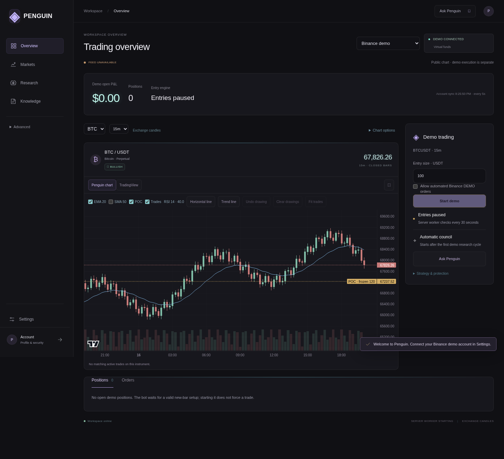
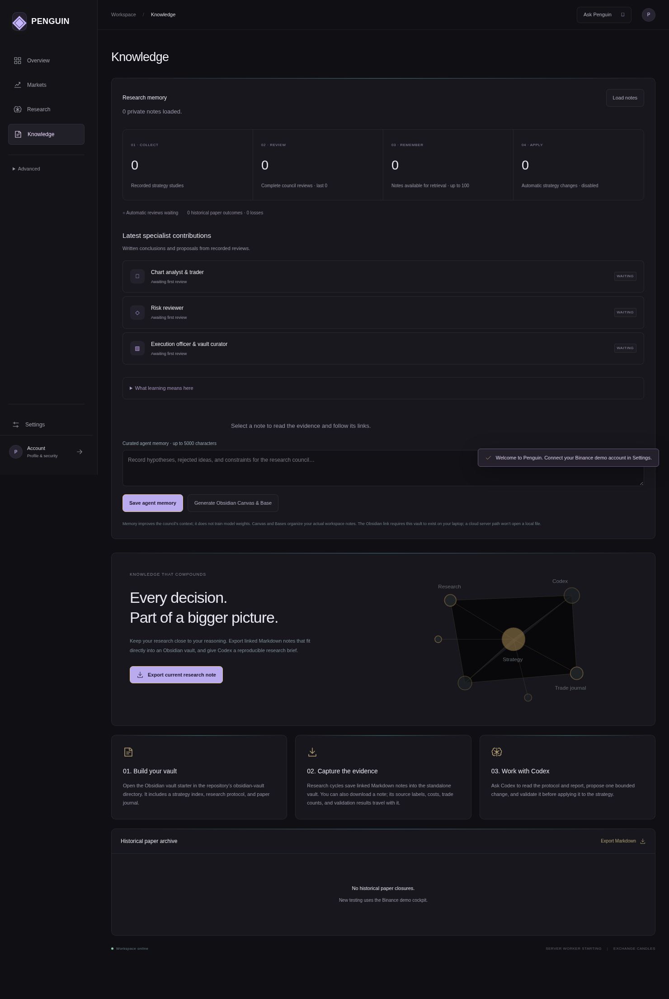

# Penguin: hosted accounts, keys, subscriptions and the new workspace

Penguin now has a quieter professional dashboard. Overview shows the selected account, P&L, positions, charts and demo controls. Markets opens a symbol when clicked. Research contains advisory specialist reports. Knowledge shows recorded evidence, specialist contributions, linked Markdown notes and what has actually been applied. Settings holds integrations. **Ask Penguin** explains application usage using the configured free cloud route; it has no execution or settings tools. JARVIS and microphone/TTS functionality are retired; old `/jarvis` bookmarks redirect to Overview.

The authenticated OpenRouter activity page was not available for direct visual inspection. The design uses a similar professional visual direction: subdued neutral surfaces, clear tables, restrained violet accents and less navigation clutter.

## Interface examples

These screenshots use synthetic exchange fixtures and empty review histories. They demonstrate layout, not exchange connectivity or trading results.





[Mobile overview](images/professional-mobile.png)

## Update an existing Windows installation

Stop Penguin with Ctrl+C. In PowerShell, enter your existing project folder, then:

```powershell
git pull origin main
npm.cmd ci
npm.cmd run build
npm.cmd run launch
```

Keep your existing private `.env.local`, `.runtime` and vault. Do not replace them with the example file or commit them. Node 24+ and Python 3.12+ are required; the previously configured Python 3.14 path is supported. No Supabase or Stripe account is necessary to keep using the existing local workspace. Do not enable hosted mode until the following setup is complete. A cloud deployment must retain its runtime directory across upgrades.

## 1. Create Supabase privately

1. Create a Supabase project under your own organization. Keep its database password in your password manager.
2. Run [the migration](../supabase/migrations/202610160001_hosted.sql) once using the project's SQL editor, or apply it with your managed Supabase migration process. It creates integration ciphertext, subscriptions and billing event tables, enables RLS and revokes all browser-role access. Only the server service role can access these records.
3. In Authentication, enable email/password and **Confirm email**. Configure your own SMTP sender for customer registration; default Supabase mail is limited and is unsuitable for a commercial launch.
4. Customize both the **Confirm signup** and **Reset password** email templates to show the code with `{{ .Token }}`. Penguin verifies email codes on its Account page; it does not consume the default email link or URL token fragments. Choose a short OTP expiry and provider rate limits.
5. Set your public HTTPS domain as the Auth site URL. Disable unused login providers. Restrict administrator access and enable MFA for your Supabase organization administrators.
6. Put these values in the server's private environment manager or its private `.env.local`. Never send them in chat or prefix them with `NEXT_PUBLIC_`:

```dotenv
PENGUIN_AUTH_PROVIDER=supabase
SUPABASE_URL=https://YOUR_PROJECT_REF.supabase.co
SUPABASE_ANON_KEY=
SUPABASE_SERVICE_ROLE_KEY=
PENGUIN_SECRET_MASTER_KEY=
TERMINAL_PUBLIC_ORIGIN=https://YOUR_DOMAIN
PENGUIN_ACCOUNT_MODE=1
PENGUIN_OPEN_SIGNUP=0
PENGUIN_SIGNUP_CODE=
TERMINAL_DATA_DIR=/var/lib/penguin
```

Enter actual values only in the private configuration. Generate a fresh master key with `node -e "console.log(require('node:crypto').randomBytes(32).toString('hex'))"` **on your trusted machine**, and save it directly into private settings and a separate encrypted recovery backup. This command intentionally prints a new secret locally; do not share its output. Generate a separate invitation value if using invitations. For public registration, set `PENGUIN_OPEN_SIGNUP=1` after testing registration and abuse controls.

The master key never goes into Supabase. AES-256-GCM binds each encrypted value to its user ID and setting name. Database copies alone cannot decrypt keys without the master key. A compromised running server holding that key can still access plaintext: encryption is not an “unhackable” guarantee. Service-role credentials must remain server-only. Protect, audit and back up both independently. Rotating the master requires re-encrypting every integration and hosted session; replacing it without migration makes old values unreadable. No automated key-rotation tool is provided yet.

Hosted users must enroll through Penguin's signup flow before obtaining an application session, including invitation checks when enabled. Supabase Auth verifies email and passwords; Penguin holds only encrypted remote tokens and opaque, hashed local sessions. Cookies are HttpOnly, SameSite=Strict and Secure on HTTPS. The server validates hosted identity before loading private state. Signing out removes the application session immediately even during a provider outage. Recovery and password changes revoke Penguin sessions; provider access JWT revocation outside Penguin follows Supabase's token-expiry behavior. End-user MFA is not implemented in this UI yet.

Use a dedicated runtime directory for a public hosted installation. An email already registered in the local account registry cannot be reused in that same registry without a separately reviewed migration. Existing local accounts and host keys are **not** silently migrated into new customer accounts. Use a new hosted account and re-enter its own integration keys through Settings. Test this with fresh accounts; switching auth modes is a deployment decision, not an automatic database migration.

## 2. Connect integrations as a customer

Sign up at `/account`, enter the emailed confirmation code, then sign in. In Settings:

1. Save Binance **demo** key and secret in their two fields, then verify demo access. Real Binance keys use separate fields and provide read-only account viewing.
2. Save a Groq or OpenRouter key. Confirm the Groq free plan if applicable, and select its route. Customer accounts use private direct free routes; the operator's shared FreeRide/9Router gateways and keys are intentionally unavailable to customers.
3. Return to Overview, choose demo, set size, tick the explicit demo-order consent and Start demo. This schedules deterministic closed-bar scans and advisory council reviews after evidence exists. A start does not force a trade. Review the first protection acknowledgements in Advanced → Advanced demo orders.
4. Use Knowledge to inspect actual reviews, evidence and memory. No model weights are trained. Demo realized fills/fees are not yet imported as a learning dataset; historical paper outcomes remain separately labelled. Automatic strategy promotion is disabled.

Secrets are encrypted in Supabase in hosted mode, not duplicated as local integration credential rows. They are decrypted into per-request/worker account context for upstream calls. The API returns configured/not configured flags, never key values. No secrets are included in AI guidance prompts. Local-only mode continues using its existing encrypted SQLite credential store.

Free routers cannot remove provider quotas, privacy restrictions or outages. Reusing a router does not create unlimited free tokens. No paid inference fallback is added. Ask Penguin consumes one bounded AI request, uses the persistent token/spending ledger and caches identical successful guidance for six hours. It explains app behavior, not live account state. Never paste keys into its question box.

## 3. Optional Stripe subscriptions

Use **Stripe test mode first**. Product pricing is your business choice; the application does not invent a price or create charges during development.

1. Create a recurring product and Price in Stripe. Copy its `price_...` identifier into `STRIPE_PRICE_ID` privately.
2. Configure your Stripe customer billing portal, including payment method updates and cancellation policy.
3. Create an HTTPS webhook endpoint at `https://YOUR_DOMAIN/api/billing/webhook`. Subscribe to `customer.subscription.created`, `customer.subscription.updated` and `customer.subscription.deleted`.
4. Save the matching test-mode `STRIPE_SECRET_KEY` and endpoint `STRIPE_WEBHOOK_SECRET` in private server settings. Do not use the publishable key in the secret-key field.
5. Restart Penguin. A signed-in customer's Account page now offers hosted checkout and billing management. Price/payment terms are displayed by Stripe before payment. Checkout returns to Account; entitlement is updated by the verified webhook, not by URL parameters.
6. Complete a test checkout, confirm the signed webhook delivery succeeds, refresh Account and confirm active status. Cancel through the portal and test renewal failures, recovery and webhook retries. Confirm two customer accounts cannot see or alter each other's plans or keys.
7. If subscriptions should gate demo trading, set `PENGUIN_REQUIRE_SUBSCRIPTION=1`. New bot enables and non-reducing demo submissions require a current active/trialing subscription at the configured price. Subscription expiry never blocks pause, close, reconcile or protection maintenance. A plan does not enable paid AI or production order execution.
8. Only switch to live Stripe configuration after test-mode validation, pricing/tax/refund terms, applicable business review and a security review. Use the live Price and live webhook signing secret together.

Webhook signatures use the raw body, constant-time HMAC comparison and a five-minute timestamp window. Current subscription state is fetched from Stripe; transactional event IDs reject replay and event/subscription creation times prevent stale updates. Checkout uses per-account idempotency keys and a matching one-hour checkout expiry to avoid overlapping checkout sessions. Protect the webhook behind a proxy that preserves the raw body. The portal/checkout are external Stripe pages; browser payment APIs are not used.

## 4. Deploy the actual backend

This release still uses **one durable Node server with one active trading worker**, account-local SQLite journals, local session/enrollment records and private Markdown vaults. Supabase hosts identity, encrypted integrations and subscriptions. It does **not** yet host the trading ledger or vault files. Do not run multiple replicas against copied runtime directories or deploy to an ephemeral serverless filesystem. That can duplicate scans/order decisions and lose journals. Never copy the same exchange keys into independently running installations.

For a durable Ubuntu 24.04 server, install Node 24+ and Python 3.12+, clone the repo, run `npm ci` and `npm run build` as a deployment user, then run `npm start` as an unprivileged service with a persistent runtime directory. [deploy/penguin.service](../deploy/penguin.service) is a starting template, not an automatically installed service: adjust its paths, Node executable and private environment file. Put HTTPS in front with a reverse proxy, restrict direct access to the app port, and make the proxy overwrite any configured `PENGUIN_TRUSTED_IP_HEADER`. Do not trust arbitrary forwarded headers.

Required outbound hosts depend on your selected integrations: your exact Supabase project hostname, `api.stripe.com`, public market endpoints and the configured AI provider. Allow the exact Supabase host rather than a broad wildcard. Browser charts connect directly to their fixed public WebSocket endpoints; optional TradingView loads its public widget. Exchange geography restrictions still apply.

Keep a consistent encrypted backup of the entire runtime directory (including SQLite WAL state and storage keys), vault and separate master key. Test restoration while the old instance is stopped. Never commit runtime data, `.env.local`, storage keys or secret backups. Build tracing excludes private runtime files. Monitor worker timestamps, exchange acknowledgements, disk space, provider failures and signed billing deliveries.

## What is verified and what is still a release prerequisite

Automated tests cover encryption tamper/account binding, hosted tenant separation, provider identity validation, unavailable-secret fail-closed behavior, free AI accounting/cache, webhook signatures and PostgreSQL RLS/event ordering. Browser checks use synthetic exchange fixtures, not real credentials.

No live Supabase project, SMTP mailbox, Stripe checkout/webhook, customer recovery mail, or actual exchange credentials were available in this development environment. Validate these against your services before selling access. This is a working integration foundation, not a completed commercial security certification. Still required for a larger commercial launch: independent security review, end-user MFA, abuse/CAPTCHA controls, auditable encrypted-key rotation, operational alerts and tested disaster recovery. Horizontal scale requires moving the authoritative trading ledger, atomic order claims, leases and vault persistence into a shared transactional architecture with a worker scheduler; adding Supabase Auth alone does not accomplish that.

The current demo strategy is a guarded long-only Fibonacci reclaim harness with separately acknowledged SL/TP plans. It is not the original repository's full strategy. Real Binance access is read-only. No backtest, model answer, UI change or subscription establishes profitability; this release cannot promise an income target.
