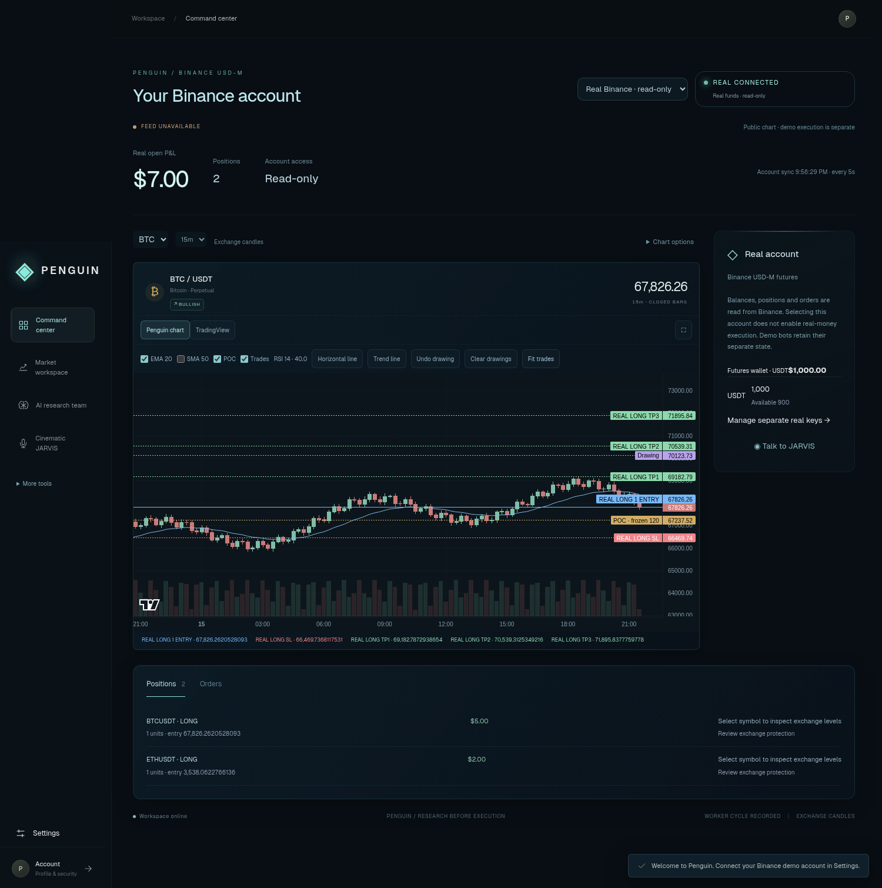
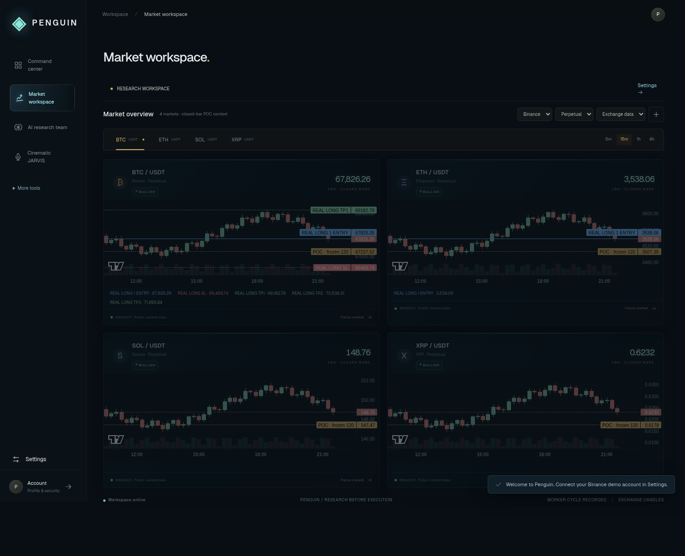

# Real Binance connection and chart workspace

## Connect your real account

This release adds **read-only real Binance Spot and USD-M futures accounts**. It does not add real-money order submission or autonomous real trading. The existing Binance demo adapter and confirmations remain separate.

1. Update Penguin and rebuild from your existing project folder:

   ```powershell
   git pull --ff-only origin main
   npm.cmd run build
   npm.cmd run launch
   ```

2. In **Settings**, unlock private settings. Save **Real Binance API key** and **Real Binance API secret**. These are separate from demo keys and remain encrypted in the account's private storage. Enable API reading in Binance and use appropriate IP restrictions. Withdrawals are not needed. The app does not enable permissions or change exchange settings.
3. Use the real-account verification button matching your key's Spot or USD-M permissions. Alternatively select **Real Binance · read-only** in the cockpit, then use Chart options → Market type to choose Spot or Perpetual.
4. A successful account read shows **REAL CONNECTED / Real funds · read-only**. Private account snapshots refresh every five seconds while the chart workspace is visible. Connection failures retain the last snapshot with stale/error status. Switching to the real viewer does not enable execution or pause existing demo bots.

Spot displays asset holdings and open orders. It does not invent average cost, open-trade P&L or an account-wide USD value from holdings. USD-M displays futures wallet balance, nonzero positions, P&L, open regular orders and readable conditional orders. If conditional-order permissions fail, that gap is shown; an entry line alone is not verified stop protection. The application uses only signed GET requests against fixed `api.binance.com` / `fapi.binance.com` account endpoints. It has no production POST/DELETE route, withdrawal or transfer implementation. Registered accounts never inherit the host's real keys or account snapshots.

Real account connectivity still depends on your permissions, IP and regional availability. Cloud tests use synthetic account responses; do not treat them as an authenticated Binance production verification.

## Focus a symbol and see its trades

Click a symbol name on a market card, a market tab, or a supported USDT instrument in the Positions/Orders table. Penguin opens its focused chart. Instrument clicks from the account table select the matching Binance context. Existing watchlist contents are preserved when opening a supported position outside the watchlist.

The **Penguin chart** overlays matching entries and available protective orders:

- Blue: real/demo entry, direction and position size.
- Red: matching native stop.
- Green: matching take-profit targets, ordered TP1 onward for real positions.
- Gold: open limit orders.
- Gray: an unverified demo leg or stale account snapshot.

Labels always include **REAL** or **DEMO**. Overlays require the matching Binance market, USDT contract and exchange-data source; demo futures positions never appear on a Spot, Bybit, Kraken or synthetic chart. Hedge-mode real orders match their position side. Missing orders are not invented. A readable open conditional order is plotted; this viewer does not perform a complete exchange-protection audit or guarantee a future fill. Public production chart prices and demo fills may differ.

Use **Trades** to toggle overlays and **Fit trades** to bring their prices into view. The legend lists prices even when a level is outside the current zoom.

## Native chart tools

The focused Penguin chart supports live forming candles, volume, pan/zoom/crosshair, fullscreen, EMA20, SMA50, an RSI14 readout, frozen POC and trade overlays. Indicator readouts use closed candles. Draw a horizontal line by selecting its tool and clicking a chart price. Draw a trend line with two points on different candles. Undo and Clear affect annotations only; they cannot place or change exchange orders.

Drawings are saved in the user's server workspace by exchange, market, symbol, timeframe and sample/exchange source. Up to 30 drawings per context and 64 contexts are supported. They survive reload and remain isolated between signed-in accounts. Studies and drawing tools are display aids; they do not modify the demo strategy.

## Bullish / bearish / neutral context

Every market card calculates the same frozen-distribution rules used by the research profile:

- Build 24 volume bins from the preceding 120 closed candles, excluding the two confirmation candles.
- Approximate each candle's volume uniformly over its high-low range; expand the value area around POC until it covers 70% of volume.
- Tolerance = max(5% of value-area width, 0.15% of POC).
- Two later closes above POC + tolerance → **Bullish**; both below POC − tolerance → **Bearish**; mixed/inside-band → **Neutral**.

Insufficient or invalid closed-bar data/volume shows **Bias unavailable**. Sample data is labelled as sample. A forming WebSocket candle cannot flip this closed-candle indication. This is estimated OHLCV context, not tick-level volume profile or an order signal. The TypeScript calculation is checked against the Python research implementation.

## TradingView option and limits

Select **TradingView** on a focused exchange chart to load its public embedded chart. The iframe receives only the public symbol and chart preferences, not account balances, keys, positions or drawings. Third-party content is isolated in its own frame. Penguin's private overlays and saved annotations remain on the Penguin chart; the public widget cannot be wired into Penguin's brokerage account.

An external widget is not the complete TradingView website or the licensed Advanced Charts/Trading Platform library. Widget availability, indicators and drawing controls are controlled by TradingView; Pine Editor, Strategy Tester, saved TradingView layouts and broker trading are not supplied by this integration. For the full library, obtain access/terms directly from TradingView before integrating a licensed datafeed and broker adapter. Their [official integration examples](https://github.com/tradingview/charting-library-examples#what-is-this-repository-about) explicitly require granted access. No restricted library was copied.

The widget needs `s.tradingview.com` and its TradingView widget resources reachable by the browser. The native chart remains available if the embed is blocked. External widget rendering is not proven by a browser fixture or an iframe load event.

## Validation and examples

102 Node tests and 16 Python research tests passed, along with lint and the production build. Browser checks passed for signed-in account reads, separate real/demo overlays with SL/three targets, saved horizontal and trend annotations, reload/undo, symbol and position focusing, account failure/stale recovery, four market bias badges, private-data exclusion from widget URLs, account/drawing isolation and 320/390 px layouts. Real-account POST attempts return 405. All exchange and widget responses in those checks were controlled fixtures; actual authenticated production access and external widget rendering remain unverified.

The screenshots below use synthetic balances, positions and market responses for UI review; they are not trading results.




