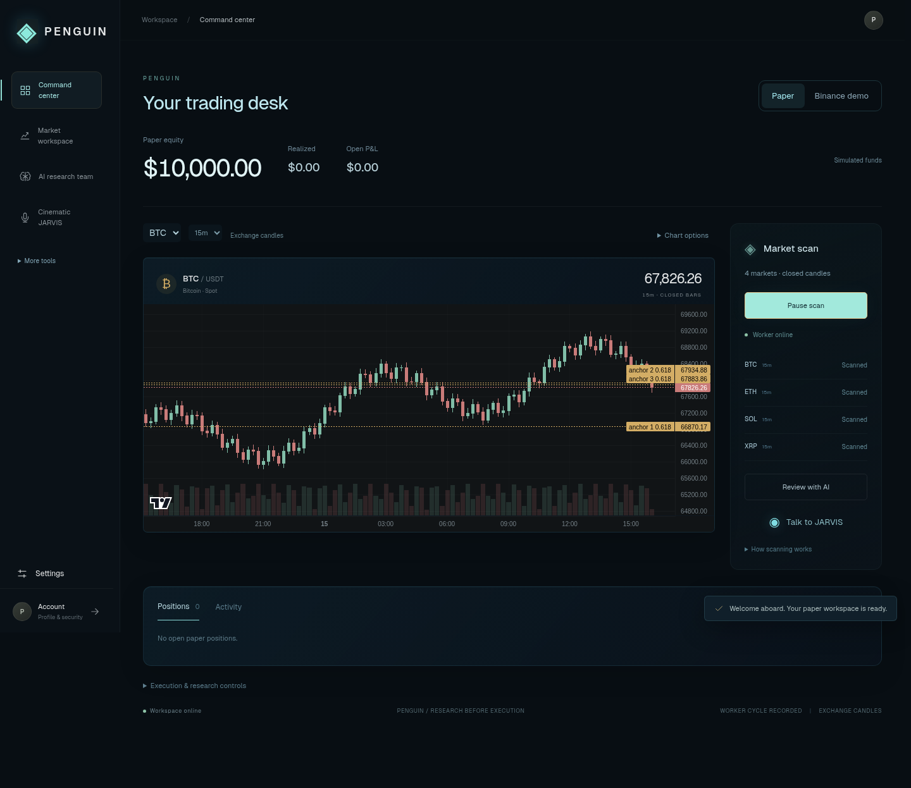

# Penguin: scanning, accounts and operation

## What actually scans

Penguin runs its own worker in `lib/server/worker.ts`, started by Next's `instrumentation.ts`. The original repository is a reference checkout, not a runtime dependency. Closing the browser does not stop the worker; stopping/sleeping the server does. This requires a persistent Node server, not a serverless deployment that suspends background timers.

The **Start scanning** button configures the current watchlist (up to eight symbols) on the selected exchange, market and timeframe, using exchange candles. It switches the chart from sample mode to exchange mode. It does not enable orders or paper automation. The worker polls every 30 seconds and runs research once per new closed candle for each configured context. Changing chart views does not change an already configured scan. To scan another configuration, pause and start with the new chart settings. Watchlist edits take effect for scanning when you restart the scan.

Paper entries can remain paused while scanning continues. Existing paper position protection still runs on its configured feed; Binance demo monitoring uses its separate worker. The dashboard shows configured markets, feed errors and the worker heartbeat. A heartbeat means a cycle completed, not that every market feed succeeded. A cycle can take longer than 30 seconds because research is sequential and bounded. There are no continuous tick feeds or intrabar exchange-native stop orders here.

Per scan:

1. Fetch validated, closed OHLCV bars from the selected Binance, Bybit or Kraken endpoint. Spot/perpetual availability follows the selected exchange. Rejected or stale feeds remain errors; the app does not substitute sample data for a live scan.
2. Run the bundled Python directional Fibonacci model and long-only 0.618 reclaim research. Baseline research uses next-bar-open entry, an anchor-derived stop, a 2R target, 24-bar timeout, 12 bps per side and a chronological 70/30 split. Training selects tolerance; the holdout vetoes it.
3. With enough bars, compare strategy families in the separate strategy lab using 60/20/20 splits and its own 2-ATR stop / 4-ATR target protocol. Fixed-range volume profile is an OHLCV-based estimate; POC/VAH/VAL and later closed-bar distribution/retest context are research evidence, not trade-level order flow.
4. Save research and linked notes to the workspace vault. Scanning itself uses **no AI tokens**. The council is a separate, bounded advisory review of that evidence.

The optional paper automation rule watches for a new closed-bar reclaim of the latest researched Fibonacci level. It remains long-only, uses at most 10% of available cash capped at $500, and sampled 2% stop / 4% target protection. This differs from the research lab's ATR exits. Other strategy families are research-only. The original fork's full macro-regime/confluence/scalp execution supervisor has **not** been ported. Penguin should not be represented as a feature-identical copy of that worker.

## Why the pasted council runs failed

Your report included Groq HTTP 429 rate limits, reported resets around 34–41 seconds, HTTP 413 request size rejections, and no eligible OpenRouter fallback. Changing routers cannot remove the underlying account quota.

The updated council bounds its evidence prompt to 9,000 UTF-8 bytes, keeps source/canonical protocol facts and selected measurements, and labels omitted context. A 413 is an explicit rejection, not an uncertain billable outcome; it permits one smaller 6,000-byte request with an output cap of at most 1,000 tokens. Direct Groq routing respects an explicit reset of up to 60 seconds before its final retry. Longer waits and exhausted quotas remain visible. Timeouts/5xx still retain reservations and are never automatically resent. Smaller prompts do not guarantee provider availability or correct model answers.

Full reports remain in storage; prompt compaction does not change research calculations. AI notes are advisory proposals and may contain errors. The three council roles have no trading/deployment tools, and vault retrieval does not train neural-network weights.

## Windows: keep the existing local workspace

From the current project folder, stop Penguin, keep any separately managed gateway terminal open, then:

```powershell
git pull origin main
npm.cmd ci
npm.cmd run build
npm.cmd run launch
```

Do not delete `.runtime`, `.env.local` or your vault. **Start scanning** researches exchange data. **Review with AI** opens the council; the council needs successful strategy evidence and a configured provider. Advanced execution controls remain in the dashboard disclosure and demo desk.

Local owner mode remains the default (`PENGUIN_ACCOUNT_MODE=0`). It preserves existing workspace cookies, encrypted integration keys, the local owner password and optional FreeRide/9Router compatibility. Signing into a new account opens a separate empty workspace; it does not migrate or claim the host's existing workspace or keys. Sign out to return to local owner mode when account mode is off.

## Invitation-based accounts

`/account` provides registration, sign-in, profile-name updates, password changes and sign-out. Passwords are salted and derived with scrypt. Random session tokens are stored as hashes, expire after seven days and can be revoked. Password changes revoke all sessions. Account mutations require same origin and HTTPS except localhost development. Authentication limits persist in SQLite.

Add these **once** to your private `.env.local` for a local invitation pilot:

```dotenv
PENGUIN_ACCOUNT_MODE=1
PENGUIN_OPEN_SIGNUP=0
# Generate a private invitation code locally; replace this placeholder before starting.
PENGUIN_SIGNUP_CODE=REPLACE_WITH_YOUR_PRIVATE_INVITATION_CODE
```

To generate a code in PowerShell:

```powershell
node -e "console.log(require('node:crypto').randomBytes(24).toString('hex'))"
```

Paste that output only into your private configuration and share it privately with invited testers. It is a shared pilot invitation, not a single-use invitation or a customer password. Restart Penguin, open `/account`, choose **Create account**, and enter the invitation. Leave `PENGUIN_OPEN_SIGNUP=0` unless intentionally opening registration. Registration is disabled when neither an invitation code nor open registration is configured.

Each registered account has:

- A stable private workspace that can be accessed again from another browser after sign-in.
- Its own SQLite ledger, encrypted key material and vault under `TERMINAL_DATA_DIR/accounts/<account-id>/`.
- Its own AI call/spending ledger, saved router choice, scanner configuration and research history.
- Private provider keys in Connections. Host environment keys, the host ledger, host vault, FreeRide and 9Router gateways are not inherited.

For customer AI, save the customer's Groq/OpenRouter key in Connections and use its **Groq free-plan confirmation** checkbox after checking the account plan. Customer routing uses direct free cloud, Groq or OpenRouter. Host gateway profiles are blocked for customer accounts so one user's evidence cannot be sent through another account's shared gateway configuration. Local owner mode retains the gateways.

Outgoing Discord webhooks are separately encrypted per account. Incoming Discord commands use `/api/integrations/discord/<account-id>` on the public HTTPS origin; find the account-specific path under Account. Save that Discord application's public key in Connections. Signature verification and one-time workspace linking remain required. The old shared incoming endpoint is disabled in hosted account mode. Discord channel notifications are supported; Discord voice calls and autonomous DMs are not.

## Hosting an invitation pilot

Run one persistent Node instance with Python installed, behind an HTTPS reverse proxy. Mount persistent private storage; back up the complete data directory (including `accounts.sqlite`, each tenant ledger and each `storage.key`) and the legacy vault. Losing an encryption key makes saved integration credentials unreadable. Do not serve the data directory as static files.

Configure the real origin, for example `TERMINAL_PUBLIC_ORIGIN=https://your-actual-domain.example`, plus `PENGUIN_ACCOUNT_MODE=1` and invitation settings. Use the actual domain, not the example. HTTPS enables secure session cookies. Keep the worker enabled. The Next process must remain alive between browser visits; do not use a request-only/serverless runtime. No public deployment was performed in this cloud coding environment.

Behind a reverse proxy, optionally set `PENGUIN_TRUSTED_IP_HEADER` to a header the proxy **overwrites and validates** (such as a deployment-controlled client identity header). Never trust a forwarded header the client can supply. Without one, a conservative aggregate origin limit is shared across callers; email-specific limits still apply. These are single-instance SQLite limits, not a distributed abuse-prevention service.

## Actual release gaps

This update adds an invitation-pilot account system; it does not make Penguin a completed commercial SaaS. Remaining work includes verified email/password recovery, MFA, customer data export/deletion workflows, payment/subscription entitlement enforcement, operator user-management tools, production monitoring/backup restore validation, a deployment-specific security review and load tests. Multi-instance background job coordination/queues are not implemented. Account-specific gateway processes are not implemented. Native Windows execution and real provider/exchange credentials have not been tested here.

Real-money order execution is unavailable. Binance demo execution remains separately guarded and uses simulated funds; demo realized income is not yet imported. Automatic execution of arbitrary AI strategy proposals, model-weight training, full original-worker parity, Discord voice calls/DMs, and a guaranteed profitable strategy are not implemented. Browser JARVIS speech and optional separately hosted TTS remain available; no movie-actor voice assets were imported.

## Interface preview

These screenshots were captured during browser tests using synthetic HTTP fixtures. They illustrate the layout; they are not live-market or profitability evidence.



[Mobile preview](images/penguin-mobile.png)

The AI router is selectable directly in Connections after unlocking/sign-in. Saved choices persist; otherwise local owner mode respects `TEAM_AI_PROVIDER` (including FreeRide) and defaults to direct free cloud when unset. Customer accounts default to private direct routing and cannot select host gateways. The older automatic migration of an explicit FreeRide environment setting to direct routing has been removed.
